 

## 🌌 About Me · Tentang Saya

> **Hello, I'm Rafly Al Razaq** — a web developer & front-end designer who loves exploring new projects.
> _Halo, saya Rafly Al Razaq — web developer dan front-end designer yang senang menjelajahi proyek baru._

|                                     |                                                                                      |
| ----------------------------------- | ------------------------------------------------------------------------------------ |
| 🪐 **Role · Peran**                 | Web Developer · Front-End Designer · Project Explorer                                |
| 📍 **Location · Lokasi**            | Bukittinggi, West Sumatra, Indonesia 🇮🇩                                              |
| 🔭 **Learning · Sedang dipelajari** | Microservices · Security Systems · Mobile Programming                                |
| ⚽ **Hobbies · Hobi**               | Futsal, Basketball, Volleyball, Gaming                                               |
| ✨ **Fun fact**                     | Always curious about how the working world operates · _Penasaran dengan dunia kerja_ |

## 🛠️ Skills & Tech Stack · Keahlian

**Languages · Bahasa pemrograman**

  

**Frameworks & Tools · Framework dan alat**

  
  

**Currently exploring · Sedang dijelajahi**

## 🚀 Featured Projects · Proyek Unggulan

<table>
  <tr>
    <td width="50%">
      
    </td>
    <td width="50%">
      
    </td>
  </tr>
  <tr>
    <td width="50%">
      
    </td>
    <td width="50%">
      
    </td>
  </tr>
</table>

## 📊 GitHub Stats · Statistik

## 💬 Life Motto · Motto Hidup

  

## 📡 Contact · Kontak

  

✦ Open to collaborate · Terbuka untuk kolaborasi ✦

